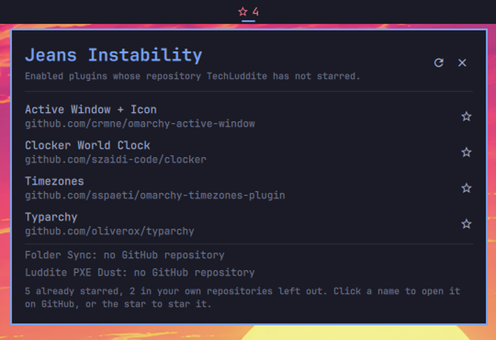

# Jeans Instability

An Omarchy bar widget that lists the GitHub repositories of your enabled third-party plugins that you have not starred yet. Click a name to open the repository, or click the empty star beside it to star it from the panel.



The name comes from astrophysics: the Jeans instability is the collapse of a gas cloud that forms new stars.

The only change it makes on GitHub is starring a repository, and only when you click that repository's star.

## Requirements

- Omarchy with the Quattro shell (`omarchy plugin` commands available).
- The GitHub CLI signed in to github.com: `gh auth login`. Omarchy installs `gh` through mise. The helper finds it with `mise which gh`, or uses `/usr/bin/gh`.
- `/usr/bin/python3`. The helper uses only the standard library.

## Install

```bash
omarchy plugin add https://github.com/TechLuddite/Jeans-Instability --enable
```

The star icon in the bar shows how many enabled plugins have a repository you have not starred. A filled star means none.

## How it decides

1. It asks the running shell for its plugin list (`omarchy-shell shell listPlugins`, the same data as `omarchy plugin list --json`) and keeps the plugins that are enabled and not first-party, apart from Jeans Instability itself.
2. For each one it reads `~/.config/omarchy/plugins/<folder>/manifest.json` and, if present, `.git/config`. The repository is the first github.com URL among the manifest `repository`, the git `origin` remote, and the manifest `homepage`.
3. It asks GitHub for the repository's current name, so a renamed repository is checked under its new name, then asks whether your account has starred it.

Repositories under your own GitHub account are left out of the list and the count. The panel footer says how many were left out.

Plugins with no github.com URL, or whose repository is gone or private, are listed under the separator with the reason.

## Starring

Clicking a row's empty star sends the request at once. While it runs, the row's text turns into braille gas that flows into the star as the star shrinks to a dot. The dot bursts into a filled star in your theme's accent colour only after GitHub confirms the star. If GitHub refuses, the row comes back with the empty star and the reason shows at the top of the panel. One star request runs at a time.

Before it sends the request, the helper checks again that the repository belongs to an enabled plugin and is not starred, so it stars nothing else.

## Terminal

The same check runs without the shell bar:

```bash
~/.config/omarchy/plugins/io.github.techluddite.jeans-instability/bin/jeans-instability
```

It prints the unstarred repositories on stdout and the summary on stderr. `--json` prints the document the panel reads. `--star OWNER/REPO` stars one repository from that list.

## Data handling

- **Network.** Only `https://api.github.com`, with your gh token: `GET /user`, `GET /repos/{owner}/{repo}`, `GET /repositories/{id}` when a repository was renamed, and `GET /user/starred/{owner}/{repo}`. Clicking a star adds `PUT /user/starred/{owner}/{repo}`, which needs the `repo` or `public_repo` scope that `gh auth login` grants by default. Redirects are not followed, proxies from the environment are ignored, each response is capped at 1 MiB, and one check stops after 60 seconds.
- **When.** Once about eight seconds after the shell starts, every six hours, when you open the panel and the last check is older than ten minutes, and when you press the refresh button or R.
- **Token.** Read from `gh auth token` into the helper process. It is never put in an argument list, an environment variable, a file or the output.
- **Files read.** The shell's plugin list, and `manifest.json` and `.git/config` in each plugin folder. Files are opened without following symlinks and are size-capped.
- **Files written.** None. The result lives in memory until the shell restarts.

## Removing

```bash
omarchy plugin remove io.github.techluddite.jeans-instability
```

Nothing survives removal. The plugin writes no state, cache, credential or configuration files of its own. Your gh login is unchanged.

## Development

```bash
python3 -m unittest discover -s test
omarchy plugin validate .
```

CI (`.github/workflows/ci.yml`) runs three jobs:

- `test`, on every push and pull request: the unit tests and `test/test_repo.py`, which checks the manifest and entry points, symlinks, agent instruction files, hidden bidirectional Unicode, `textFormat` on every QML `Text`, bounded process output, and the marketplace scanner's file limits.
- `scout`, on push: [Luddite Scout](https://github.com/TechLuddite/Luddite-Scout) at a pinned commit reviews the repository as GitHub serves it. Any HIGH or MEDIUM finding fails the job.
- `baseline`, on push: the marketplace's Automated Security Baseline at a pinned commit scans the pushed commit. Anything other than `passed` with no findings fails the job.

## Security

Report vulnerabilities privately, as described in [SECURITY.md](SECURITY.md).

## Licence

MIT. See [LICENSE](LICENSE).
